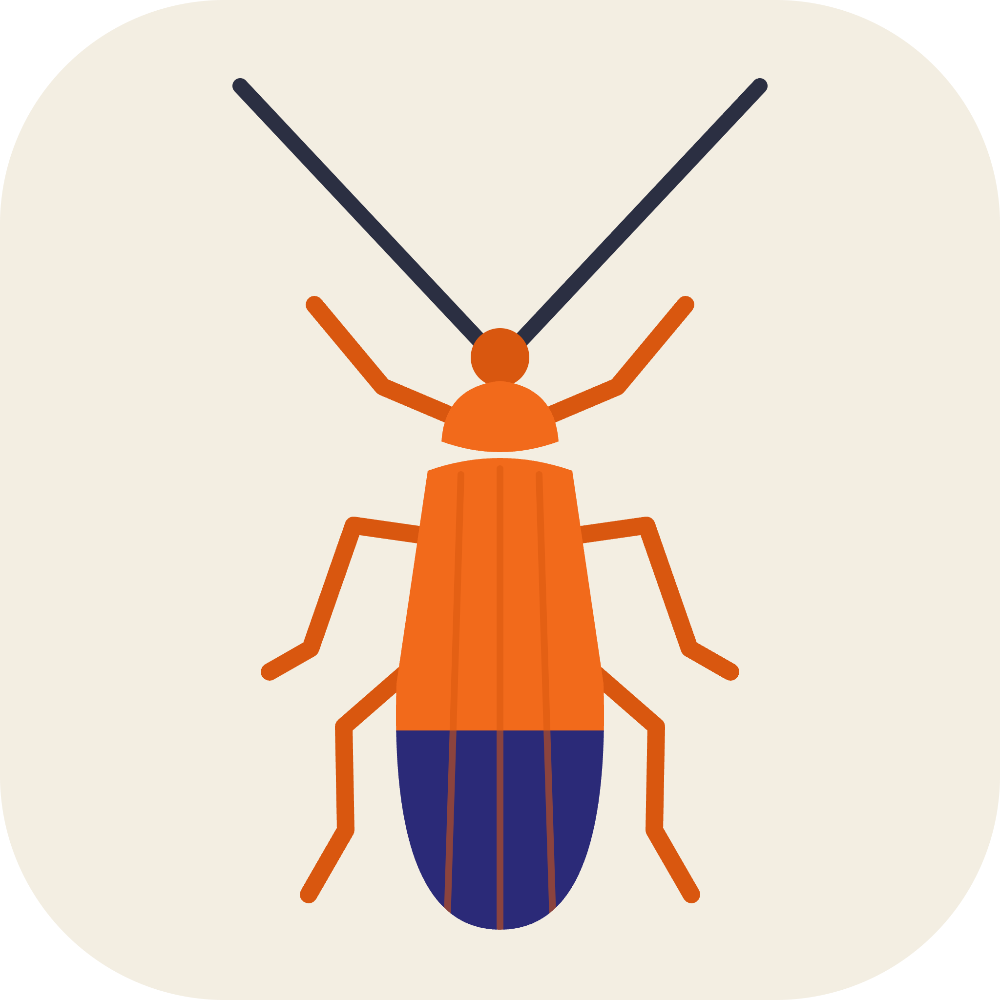

  

# Beetlescriber
**A standalone application for preparing taxonomic descriptions of beetle genera and species.**

Beetlescriber is a browser-based application designed to facilitate the preparation, organization, and standardization of morphological descriptions in beetle taxonomy.

The application provides a structured interface for recording morphological observations, compiling genus- and species-level descriptions, managing taxonomic information, and generating formatted text for scientific manuscripts.

### Features

- Structured morphological character fields.
- Genus- and species-level description builder.
- Support for variable morphological characters among species.
- Live preview of generated taxonomic descriptions.
- Editable generated text.
- Custom morphological fields.
- Figure references and taxonomic information management.
- DOCX and TXT export.
- Local project saving and loading.

### Installation and use

Beetlescriber does not require installation, an account, or a remote server.

1. Download `index.html`.
2. Open the file in a modern web browser.
3. Start preparing your taxonomic descriptions.

The application runs locally in the browser.

### Development and attribution

Beetlescriber was developed by Vinicius S. Ferreira, with assistance from ChatGPT (OpenAI) and Claude (Anthropic) in generating and refining the application code. The application and its functionality were reviewed by the author.

### Author

Vinicius S. Ferreira  
Senckenberg German Entomological Institute  
Müncheberg, Germany

### Citation

Ferreira VS (2026) Beetlescriber v1.0: A standalone browser-based application for preparing taxonomic descriptions of beetle genera and species. GitHub repository.

### License

See the LICENSE file.
